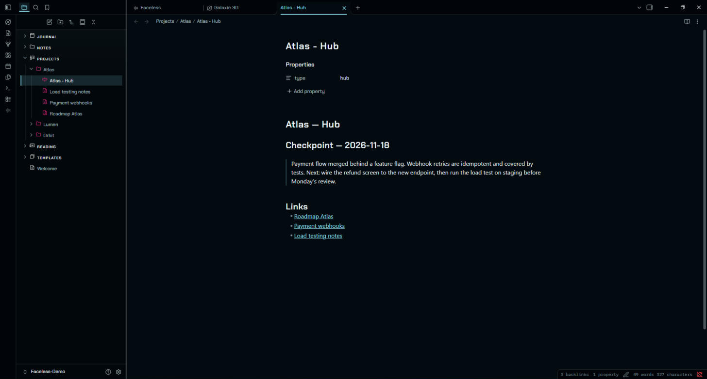

# Faceless HUD

An Obsidian theme in the style of a sci-fi heads-up display: a deep blue-black background, white-dominant interface, an ice-blue "reactor" accent for the normal state and amber for warnings.

- Interface, headings and numbers in Chakra Petch and IBM Plex Mono (embedded, no network requests). Note text keeps Obsidian's reading font.
- Top-level folders in spaced capitals; the active file is marked with a thin blue edge.
- Active tab underlined, sharp corners, quiet borders.
- Unresolved links in amber.

**Dark mode only.** In light mode Obsidian's default colors apply.

It is the standalone version of the theme included in the [Faceless](https://github.com/precieuxfassinou/faceless) plugin; you do not need both.



## Installation

1. In Obsidian, open **Settings → Appearance → Themes → Manage**.
2. Search for **Faceless HUD**, then click **Install and use**.
3. Make sure **Settings → Appearance → Base color scheme** is set to **Dark**.

Manual install: create the folder `.obsidian/themes/Faceless HUD/` in your vault, copy `theme.css` and `manifest.json` from the [latest release](https://github.com/precieuxfassinou/faceless-hud/releases/latest) into it, then pick the theme under **Settings → Appearance → Themes**.

## Customization

The theme has no Style Settings options. Every color and font comes from a few CSS variables, so you can change them with a snippet:

1. Create a file such as `faceless-tweaks.css` in `.obsidian/snippets/`.
2. Override the variables you want, for example:

```css
.theme-dark {
  --fl-ice: oklch(0.80 0.12 160);   /* main accent (default ice blue) */
  --fl-amber: oklch(0.75 0.16 30);  /* warnings and unresolved links */
  --fl-void: oklch(0.12 0.01 250);  /* background */
}
```

3. Enable the snippet under **Settings → Appearance → CSS snippets**.

Other variables: `--fl-void-2`, `--fl-panel`, `--fl-line`, `--fl-line-strong`, `--fl-white`, `--fl-muted`, `--fl-dim`, `--fl-sans` (interface font) and `--fl-mono` (numbers and labels).

## Credits

- Chakra Petch and IBM Plex Mono: SIL Open Font License 1.1.
- Theme: MIT License.

---

**Français.** Thème façon HUD de science-fiction : fond bleu nuit, interface à dominante blanche, accent bleu « réacteur », ambre pour les alertes. Thème sombre uniquement. Polices embarquées, aucune requête réseau.
