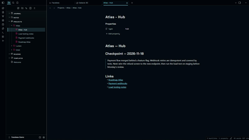

# Faceless HUD

An Obsidian theme in the style of a sci-fi heads-up display: a deep blue-black background, white-dominant interface, an ice-blue "reactor" accent for the normal state and amber for warnings.

- Interface, headings and numbers in Chakra Petch and IBM Plex Mono (embedded, no network requests). Note text keeps Obsidian's reading font.
- Top-level folders in spaced capitals; the active file is marked with a thin blue edge.
- Active tab underlined, sharp corners, quiet borders.
- Unresolved links in amber.

**Dark mode only.** In light mode Obsidian's default colors apply.

It is the standalone version of the theme included in the [Faceless](https://github.com/precieuxfassinou/faceless) plugin; you do not need both.

## Credits

- Chakra Petch and IBM Plex Mono: SIL Open Font License 1.1.
- Theme: MIT License.

---

**Français.** Thème façon HUD de science-fiction : fond bleu nuit, interface à dominante blanche, accent bleu « réacteur », ambre pour les alertes. Thème sombre uniquement. Polices embarquées, aucune requête réseau.
